**Course:** Object-Oriented Programming  
**Language / GUI:** Java 21, Swing  
**Submitted by:** _(your name / group members)_  
**Date:** October 2026

# 1. Project Title

**Library Management System** (Java Swing)

# 2. Project Description

The Library Management System is a desktop application that helps a small school or community library manage its collection, its members and the lending of items. Librarians can record books, magazines and DVDs, register students and faculty members, lend and receive items, and view reports on overdue loans and collected late fees.

The program is written in Java with a Swing graphical user interface. It is organised into model classes (the real-world objects), a service class (the business rules) and GUI classes (the screens), and it applies all four pillars of Object-Oriented Programming.

# 3. Problem Statement

Many small libraries still track borrowed items on paper or in spreadsheets. This leads to several problems:

- Staff cannot quickly tell whether an item is available or who has it.
- Due dates and late fees are calculated by hand, which causes mistakes and inconsistent rules.
- Different kinds of items (a book, a magazine, a DVD) and different kinds of borrowers (a student, a teacher) need different rules, which are hard to apply consistently.
- Invalid data (blank names, wrong dates, duplicate records) goes unnoticed.

This application addresses these problems by keeping all records in one system, applying the correct loan and fee rules automatically, and rejecting invalid input.

# 4. Objectives

1. Develop a functional Java GUI application that models a real-world library.
2. Design classes and objects with clear responsibilities and relationships.
3. Apply **encapsulation** to protect and manage the data of every object.
4. Apply **inheritance** to share common code between related classes (items and members).
5. Apply **polymorphism** so that different item and member types behave differently through the same method calls.
6. Apply **abstraction** through abstract classes and an interface that capture essential behaviour.
7. Provide input validation and error handling so that invalid data and invalid transactions are never processed.
8. Provide a clear, organised GUI for all major functions.

# 5. System Features

| # | Feature | Description |
|---|---------|-------------|
| 1 | **Add / view items** | Add books, magazines and DVDs. Each type has its own extra field (ISBN, issue number, duration). IDs (B001, M001, D001) are generated automatically. |
| 2 | **Search items** | Search by ID, title or author and filter by item type. |
| 3 | **Update / delete items** | Select an item to edit its details or remove it. An item that is on loan cannot be deleted. |
| 4 | **Register / manage members** | Register students and faculty members (IDs S001, F001...), search them, and delete members who have no borrowed items. Duplicate email addresses are rejected. |
| 5 | **Borrow items** | Lend an available item to a member. The system calculates the due date from the item type and member type, and enforces borrowing limits and the no-overdue rule. |
| 6 | **Return items and calculate late fees** | Return a loan; the system calculates the late fee using the item's fee rule and the member's discount. |
| 7 | **Overdue report** | Lists all overdue loans for any chosen date, with the fee that would be charged. |
| 8 | **Statistics and loan history** | Shows total items, available items, members, active loans, overdue loans, fees collected and the full loan history. |

### Business rules

| Item type | Loan period | Late fee per day | Special rule |
|-----------|-------------|------------------|--------------|
| Book | 14 days | PHP 5 | none |
| Magazine | 7 days | PHP 3 | none |
| DVD | 3 days | PHP 20 | fee capped at PHP 500 |

| Member type | Max items | Extra loan days | Late-fee discount |
|-------------|-----------|-----------------|-------------------|
| Student | 3 | 0 | 0% |
| Faculty | 10 | 7 | 50% |

Due date = borrow date + item loan period + member extra days. A member with an overdue item cannot borrow until it is returned.

# 6. OOP Implementation

## 6.1 Class overview

| Package | Class | Responsibility |
|---------|-------|----------------|
| `library.model` | `Borrowable` (interface) | Contract for anything that can be lent |
| | `LibraryItem` (abstract) | Common data and behaviour of all items |
| | `Book`, `Magazine`, `DVD` | Specific item types |
| | `Member` (abstract) | Common data and rules of all members |
| | `Student`, `Faculty` | Specific member types |
| | `Loan` | One borrowing transaction |
| | `ItemType`, `MemberType` | Enumerations of the types |
| `library.service` | `LibraryService` | All business rules and data storage |
| | `LibraryException` | Business-rule errors |
| | `SampleData` | Demo data |
| `library.util` | `Validator`, `Money` | Input validation and money formatting |
| `library.ui` | `RefreshablePanel` (abstract) | Shared base of all tabs |
| | `ItemsPanel`, `MembersPanel`, `CirculationPanel`, `ReportsPanel` | The four screens |
| | `MainFrame` | Main window |
| `library` | `Main` | Program entry point |

## 6.2 Encapsulation

| Where | How it is applied |
|-------|-------------------|
| `LibraryItem` | Fields `id`, `title`, `creator`, `year`, `available` are `private`. They are read with getters and changed only with `setTitle`, `setCreator`, `setYear`, `checkOut` and `checkIn`, which validate the new value first (blank title, year range, double check-out). The `id` has no setter, so it can never change. |
| `Book`, `Magazine`, `DVD` | `isbn`, `issueNumber` and `durationMinutes` are private and can only be set through `setExtraValue`, which validates the format (10/13-digit ISBN, issue 1-9999, duration 1-600). |
| `Member` | `id`, `name` and `email` are private. `setName` and `setEmail` validate letters-only names and email format. |
| `Loan` | All fields are private. The fee and return date can only be set through `markReturned`, so a loan cannot be given an arbitrary fee. |
| `LibraryService` | The collections `items`, `members` and `loans` are private. `getAllLoans()` returns an unmodifiable list so outside code cannot change the records directly. |
| GUI classes | All fields (text fields, tables, combo boxes) are private. |

Test evidence: the automated test *"every instance field in the model classes is private"* checks this with reflection.

## 6.3 Inheritance

| Parent class | Child classes | Relationship |
|--------------|---------------|--------------|
| `LibraryItem` | `Book`, `Magazine`, `DVD` | Each is a kind of library item. The children reuse the id, title, creator, year, availability, `checkOut()`, `checkIn()` and the default `calculateLateFee()` from the parent and add only what is different (ISBN / issue number / duration, loan period, fee rate). |
| `Member` | `Student`, `Faculty` | Each is a kind of member. The children reuse id, name, email, validation and `applyDiscount()` and add their own borrowing privileges. |
| `RefreshablePanel` (extends `JPanel`) | `ItemsPanel`, `MembersPanel`, `CirculationPanel`, `ReportsPanel` | Every tab reuses the shared error dialogs, table setup and `attempt()` helper. |
| `Exception` | `LibraryException` | Custom error type for business-rule violations. |

Without inheritance, the code for id, title, year, availability and validation would be repeated in three item classes and two member classes.

## 6.4 Polymorphism

| Where | Behaviour |
|-------|-----------|
| `getLoanPeriodDays()` | The same call returns 14 for a `Book`, 7 for a `Magazine` and 3 for a `DVD`. |
| `getLateFeePerDay()` / `calculateLateFee(days)` | Each item type has its own rate. `DVD` **overrides** `calculateLateFee()` to cap the fee at PHP 500 (method overriding). |
| `getMaxLoans()`, `getExtraLoanDays()`, `getFeeDiscount()` | `Student` and `Faculty` return different values for the same calls. |
| `Loan` and `LibraryService.borrowItem()` / `returnItem()` | These methods work with the parent types `LibraryItem` and `Member` only. When they call `item.getLoanPeriodDays()` or `item.calculateLateFee(...)`, Java runs the version belonging to the real object (dynamic binding). Adding a new item type needs no change in these methods. |
| `LibraryService.addItem(...)` | Returns a `LibraryItem` reference that is really a `Book`, `Magazine` or `DVD`. |
| `refresh()` in `MainFrame` | The tab-change listener calls `refresh()` on any `RefreshablePanel`; each tab reloads its own data in its own way. |
| `setExtraValue()` / `getExtraValue()` | The GUI uses one form field for every item type; each subclass validates and stores it differently (ISBN, issue number, duration). |

Example from the program: returning a DVD 33 days late through `loan.markReturned(date)` produces a fee of PHP 500 (capped), while a book 33 days late would produce PHP 165, using exactly the same line of code.

## 6.5 Abstraction

| Abstraction | Purpose |
|-------------|---------|
| `Borrowable` (interface) | Defines *what* a lendable object can do (`isAvailable`, `checkOut`, `checkIn`, `getLoanPeriodDays`, `calculateLateFee`) without saying *how*. `LibraryItem` implements it. |
| `LibraryItem` (abstract class) | Represents the general idea of "a library item". It cannot be instantiated. It declares abstract methods `getType()`, `getLateFeePerDay()`, `getLoanPeriodDays()`, `getExtraValue()` and `setExtraValue()` that each concrete item must define. |
| `Member` (abstract class) | Represents the general idea of "a member". Abstract methods `getType()`, `getMaxLoans()`, `getExtraLoanDays()` and `getFeeDiscount()` force each member type to define its privileges. |
| `RefreshablePanel` (abstract class) | Represents "a screen that can reload its data". Abstract method `refresh()` must be implemented by each tab. |
| `LibraryService` | Hides all storage and rule details from the GUI. The screens just call `borrowItem(...)` and do not know how loans are stored or validated. |

# 7. UML Class Diagram

The class diagram is split into two figures for readability: Figure 1 shows the domain model and service layer; Figure 2 shows the GUI layer. Notation: `+` public, `-` private, `#` protected; *italic* = abstract; underlined = static; hollow triangle = inheritance; dashed hollow triangle = interface realization; filled diamond = composition; dashed open arrow = dependency.

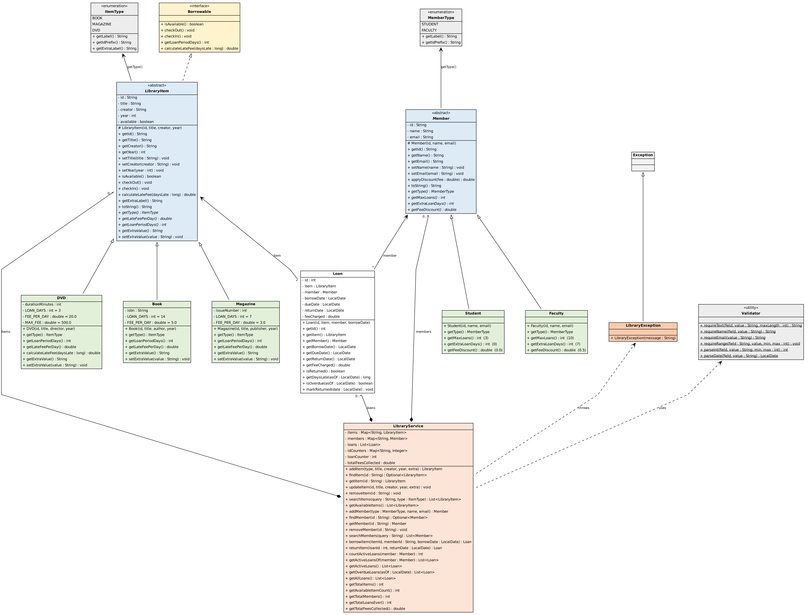

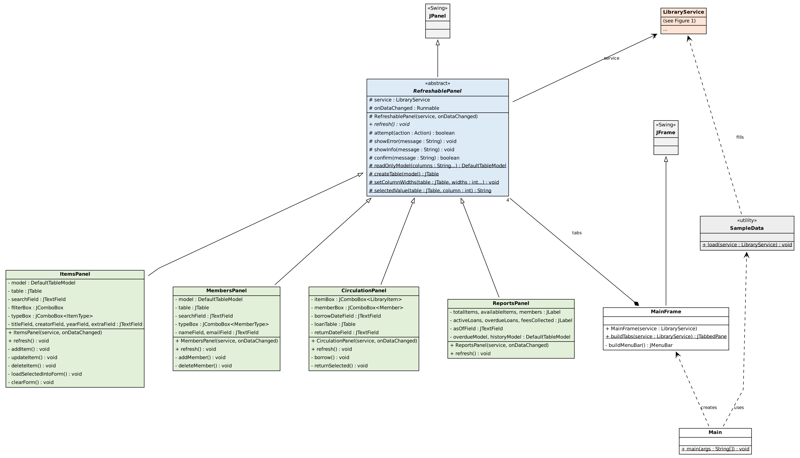

# 8. GUI Screenshots

**Items screen** - list, search, add, update and delete items.

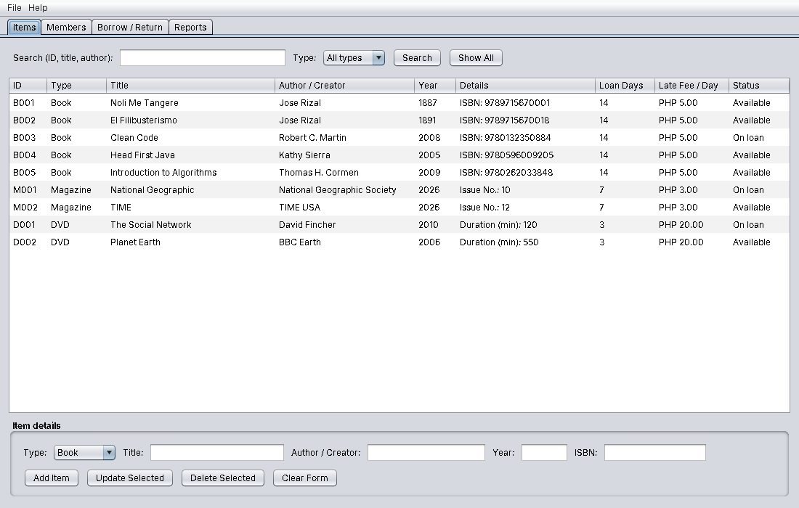

**Validation on the Items screen** - a blank title is rejected.

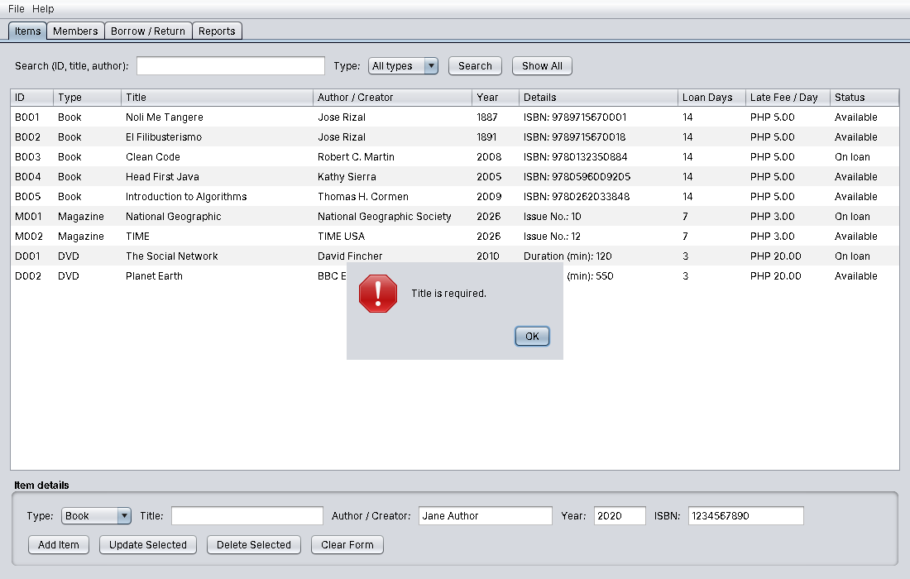

**Adding an item** - success message.

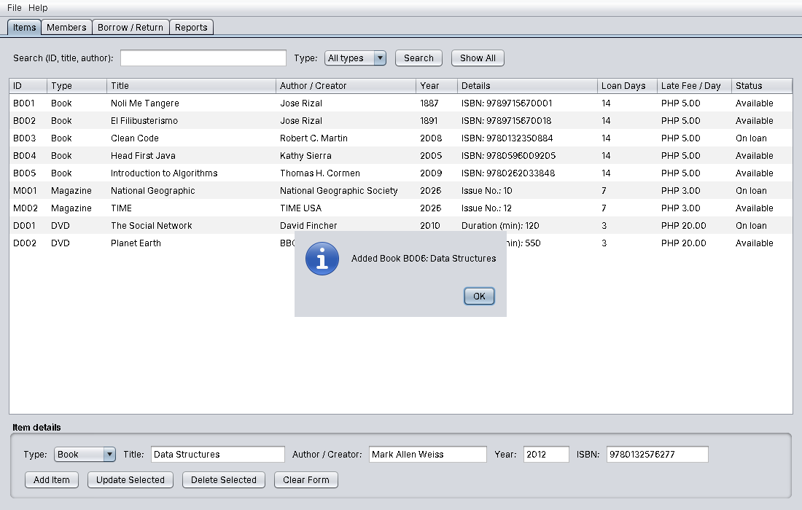

**Searching items** - results for "rizal".

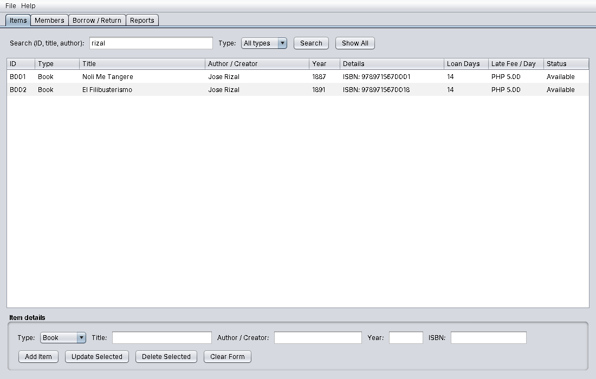

**Members screen**

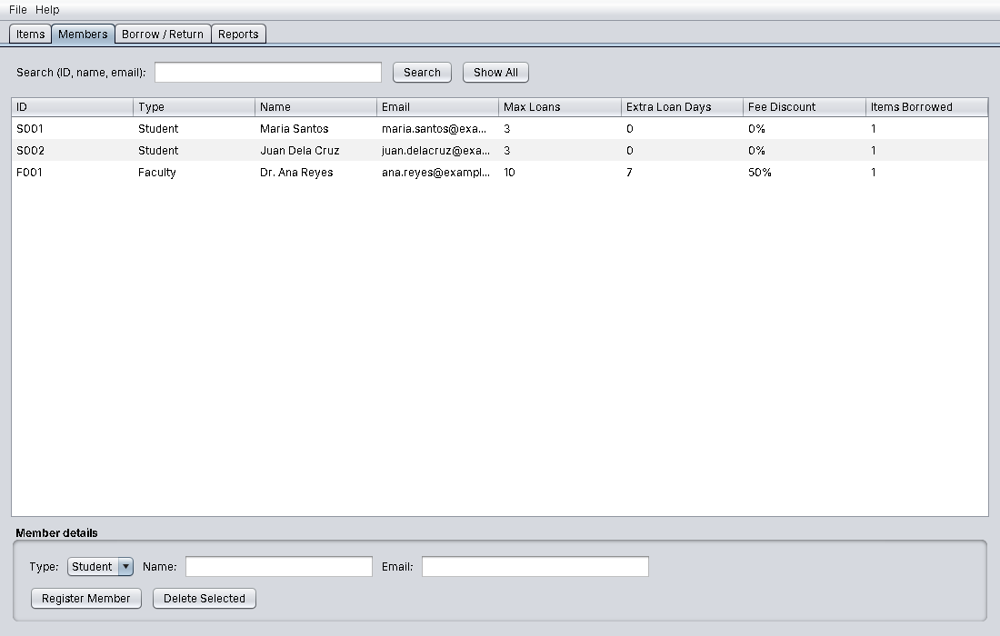

**Member validation** - an invalid email address is rejected.

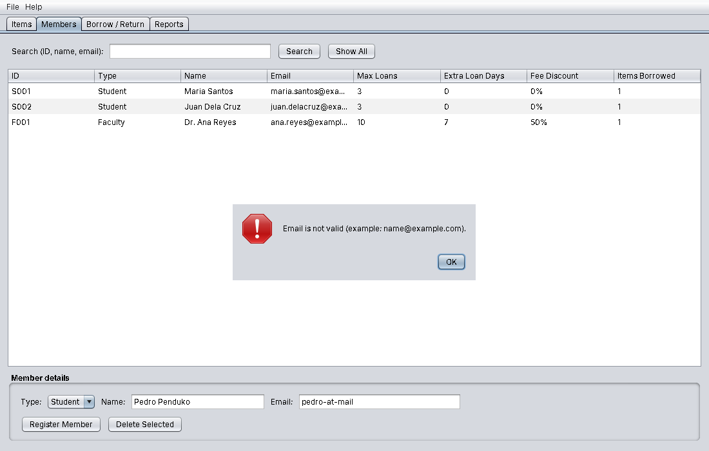

**Registering a member**

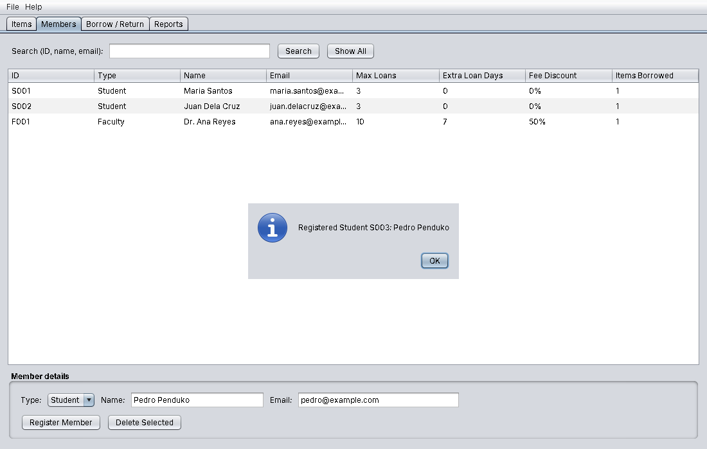

**Borrow / Return screen** - available items, members, and the list of active loans with their status.

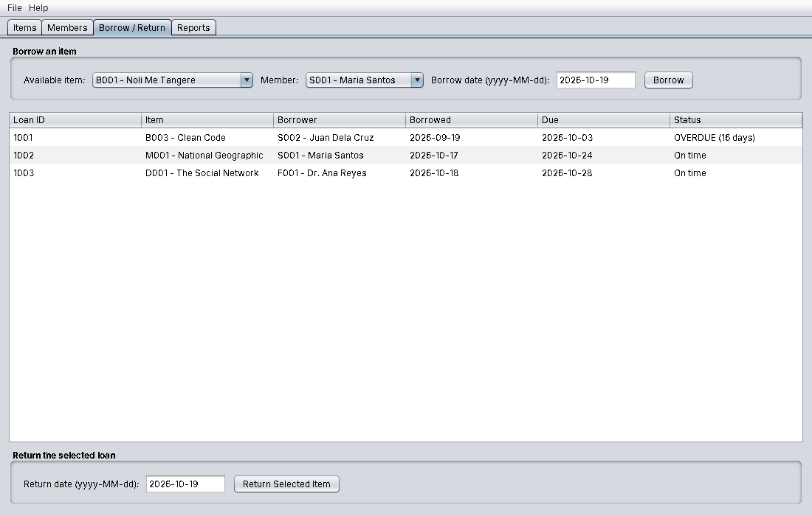

**Invalid transaction prevented** - a member with an overdue item cannot borrow.

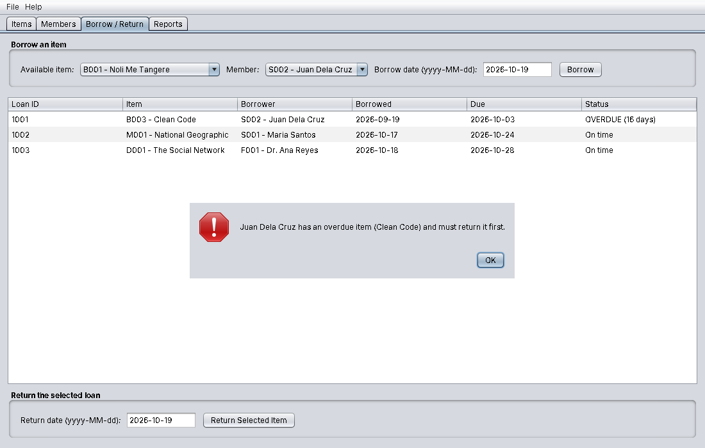

**Borrowing an item** - the due date is calculated automatically.

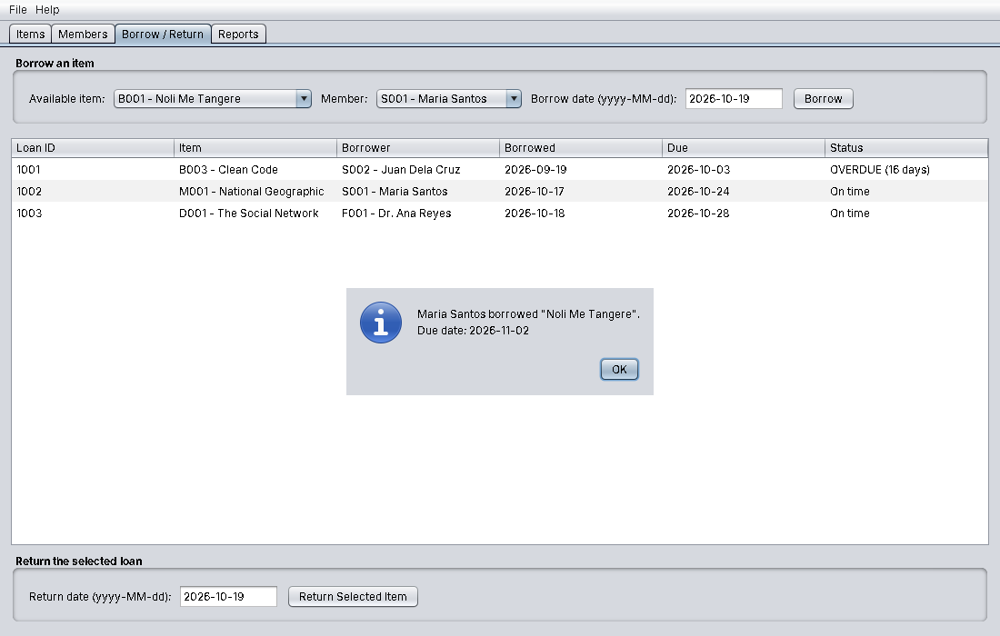

**Returning a late item** - 16 days late x PHP 5 = PHP 80.

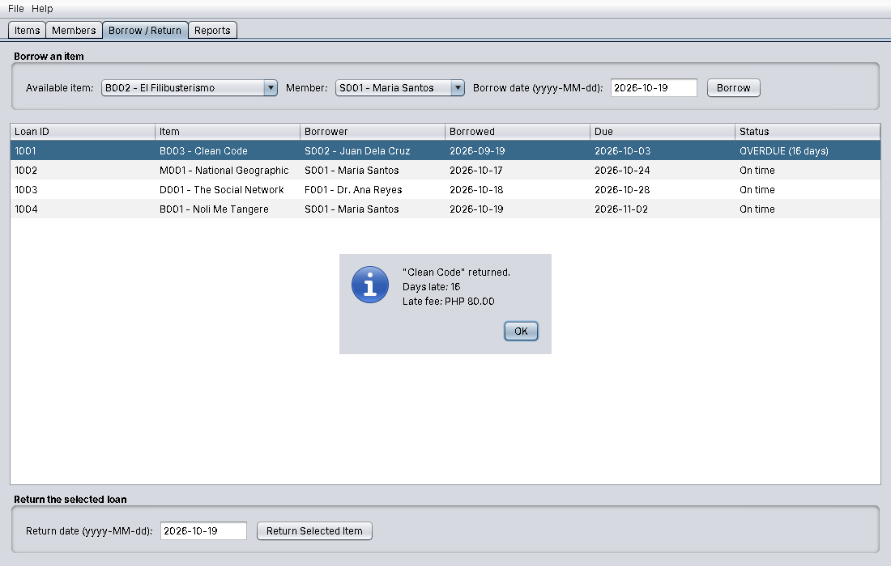

**Reports screen** - statistics, overdue report and loan history.

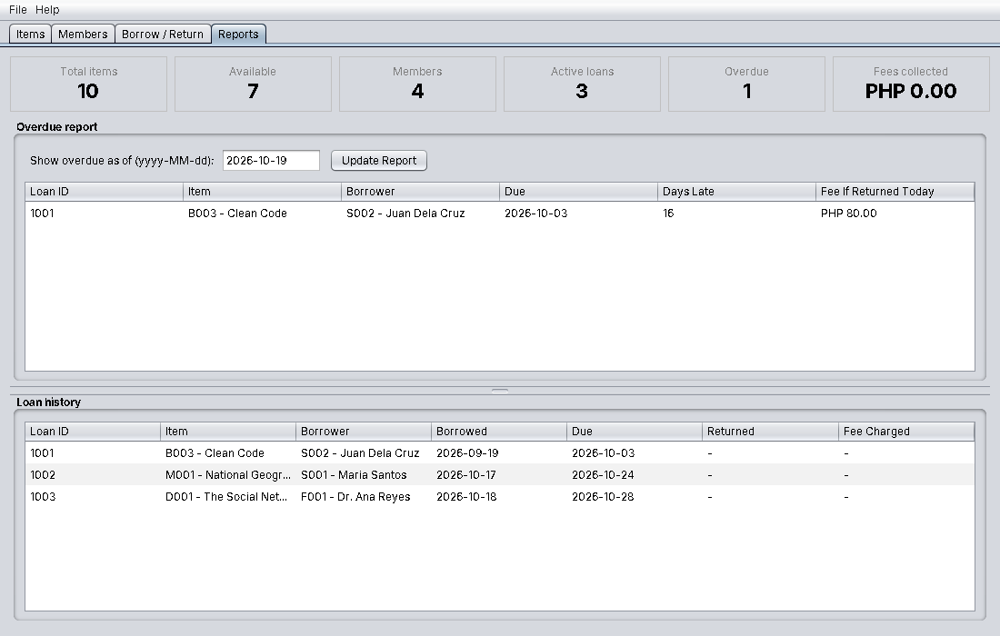

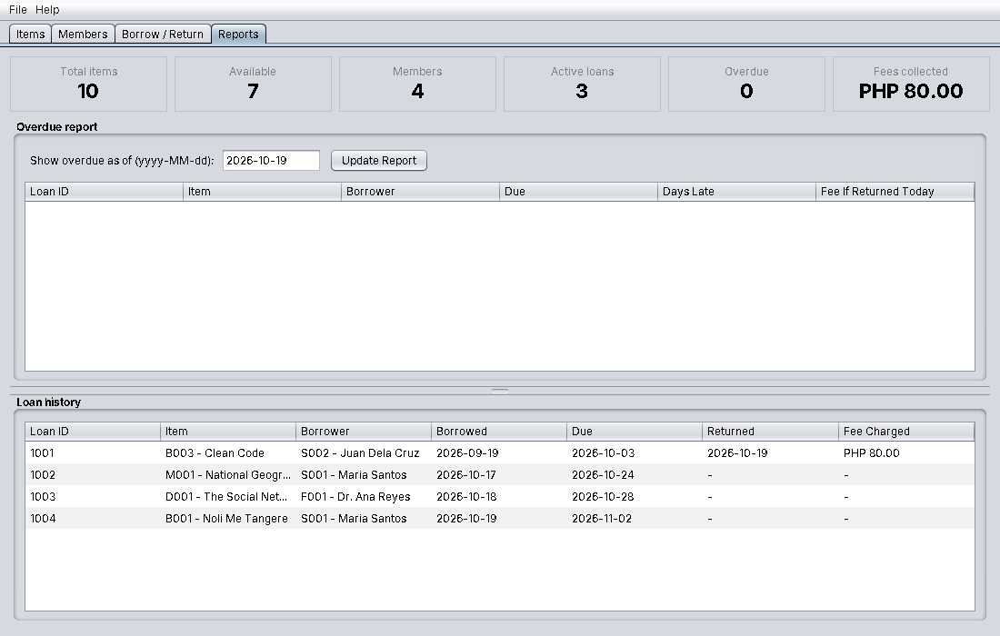

# 9. Testing

## 9.1 Input validation and error handling

| Input | Rule | Result shown |
|-------|------|--------------|
| Blank title / author | Required fields | "Title is required." |
| Year "abc", 999 or 3000 | Whole number between 1000 and next year | "Year must be a whole number." / "Year must be between ..." |
| ISBN "12345" | 10 or 13 digits | "ISBN must contain 10 or 13 digits." |
| Issue number 0, duration -5 or "abc" | Positive whole number in range | Error message |
| Member name "John123" | Letters, spaces, dots, apostrophes, hyphens only | Error message |
| Email "pedro-at-mail" | Valid email format | "Email is not valid." |
| Duplicate email | Must be unique | "A member with the email ... already exists." |
| Date "19/10/2026" | Format yyyy-MM-dd | "... must use the format yyyy-MM-dd" |
| Borrow date in the future | Not allowed | Error message |
| Return date before borrow date or in the future | Not allowed | Error message |
| Borrow an item already on loan | Not allowed | "... is already borrowed." |
| Student borrows a 4th item | Limit of 3 | "... has reached the limit of 3 items" |
| Member with overdue item borrows | Not allowed | "... has an overdue item ... must return it first." |
| Delete item or member that is in use | Not allowed | Error message |

All errors are shown in dialog boxes and nothing is changed when an error occurs (for example, a failed item update is rolled back).

## 9.2 Automated test results

The test class `LibraryServiceTest` runs 31 checks against the service and model classes (run with `java -cp out library.LibraryServiceTest`).

**Result: 31 passed, 0 failed.**

| Area | Tests (all passed) |
|------|--------------------|
| Features | Add item with generated IDs; search by title / author / ID / type; update item; update rollback on invalid data; delete item; register and search members |
| Borrowing and returning | Due date for book/student (+14) and book/faculty (+21); item already on loan; student limit of 3 and faculty higher limit; borrowing blocked by overdue item; on-time return; item becomes available again |
| Late fees | Book/student 10 days = PHP 50; Book/faculty 10 days = PHP 25 (50% discount); Magazine 4 days = PHP 12; DVD 33 days capped at PHP 500; total fees tracked |
| Reports and rules | Overdue report; cannot delete item/member on loan |
| Validation | Blank fields; year range; ISBN / issue / duration; rejected item does not consume an ID; member name and email; duplicate email; invalid dates; unknown IDs |
| OOP pillars | Encapsulation (all fields private, checked by reflection); Inheritance (class hierarchy); Abstraction (abstract classes and interface); Polymorphism (same call, different results per subclass) |

## 9.3 GUI testing

The screenshots in section 8 were produced by running the real application and operating its buttons and fields: adding an item (valid and invalid), registering a member (valid and invalid), borrowing (allowed and blocked), returning a late item with a fee, and opening the reports.

# 10. Conclusion

Developing the Library Management System showed how the four pillars of OOP work together in one application:

- **Encapsulation** kept every object's data private and valid, so errors are caught at the place where the data is stored, not only in the GUI.
- **Inheritance** removed duplicated code: the shared parts of items, members and screens are written once in the parent class.
- **Polymorphism** let one piece of code (`borrowItem`, `returnItem`, `markReturned`) handle every item and member type, each following its own rules, so new types can be added with little change.
- **Abstraction** separated *what* the system does from *how*: the abstract classes and interface define the essential behaviour, and the service layer hides the details from the GUI.

Separating the program into model, service and GUI classes also made it easier to test (the service can be tested without opening any window) and to explain. Possible future improvements are saving data to a file or database, a login system for librarians, and reservation of borrowed items.
